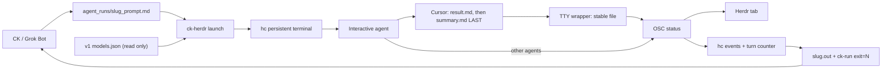

# ck-run v2 on Herdr

`ck-herdr` is a small interactive launcher using the installed `hc` runtime.
Herdr displays the persistent terminals; this repository supplies the bridge
from CK prompt files to the completion line Grok Bot watches. It uses Python
stdlib only. It does not install or replace ck-run v1.



| Existing concept | Herdr mapping here |
| --- | --- |
| ask | `ask` terminal label; launches appear in the CK space by default. |
| run | A persistent terminal/tab named after the slug. |
| model alias | Read from `~/PhD_local/ck-dispatch/config/models.json`; also a terminal label. |
| stall | A reported `blocked` status returns a blocked result. There is no watchdog or screen-text inference. |
| wake | The final `ck-run exit=N` line in `agent_runs/<slug>.out` is compatible with the existing watcher. No message is sent. |
| ledger, budgets, andon, reviews | Remain in v1. This launcher does not call or enforce those workflows. |

Use the existing CK process to authorize work and check its budgets/andon
before launching. This is a transport prototype, not a replacement policy gate.

## Use

Put the complete authorized task and output contract in
`~/PhD_local/agent_runs/<slug>_prompt.md`, then run:

```sh
bin/ck-herdr launch my-task --model sol --cwd ~/PhD_local/ck-herdr \
  --ask A-example --title 'Task title'
bin/ck-herdr ls
```

The launcher starts `hc run --bg --outlive-parent`, labels the terminal, and
blocks on `hc events --terminal <slug>` for agents with status reports. Run it in a persistent supervising terminal when
the completion watcher must survive closing the invoking shell. The agent
terminal itself outlives the launcher. The title becomes part of the initial
task; the tab name remains the slug.

Launches hold a repository-local advisory file lock (`.space.lock`) around looking up the space named `CK` with `herdr-app ls` and creating it in `~/PhD_local/agent_runs` when missing. Use `--space NAME` to choose another name. The resolved `herdr.space` label is passed in the initial `hc run`, so the window can show the agent as a tab. If the app or window is unavailable, the agent still launches with one warning. Dry-run only prints the planned lookup, conditional creation, and label; it makes no app or core calls.

Dry-run works before or after the subcommand, including the requested form:

```sh
bin/ck-herdr launch --dry-run my-task --model sol --cwd ~/PhD_local/ck-herdr
bin/ck-herdr --dry-run launch my-task --model sol --cwd ~/PhD_local/ck-herdr
```

It prints the run/label/wait/read commands and output path. It performs no
`hc` calls and writes no files; a prompt file need not exist for this preview.
Live launches require the prompt file and refuse an existing `.out`, including
a symlink. Names follow `hc run --help`: lowercase letters, digits, hyphen,
underscore, and at most the length allowed there. Uppercase CK ask identifiers
belong in `--ask`, not the slug.

`ls` is a plain tab-separated table of live terminals tagged `ck-herdr=true`.
It uses the server's label filter, then `hc get` for the labels omitted from
compact list rows. It does not enumerate unrelated run files or change tabs.

## Commands and safety

The current alias file contains agent/model/effort metadata, not shell lines.
The launcher constructs an interactive command for each supported agent:

| Agent | Invocation behavior |
| --- | --- |
| codex | `codex --no-daemon --sandbox workspace-write --approve-for-me -m MODEL`; verified reasoning effort from the alias file. |
| claude | `claude --model MODEL`; verified effort when configured; normal permission handling. |
| cursor | `python3 bin/ck-herdr-cursor RUN_FOLDER -- agent --auto-review --sandbox enabled --model MODEL TASK`; the child stays interactive on the same tty. |
| agy | `agy --prompt-interactive TASK`; default model when the alias has none. |

There is no `codex exec`, print mode, shell evaluation, or permission bypass.
The optional argv-array `command` alias form exists for local fake fixtures.
Known bypass flags in such arrays are removed with a stderr and `.out` note;
permission-disabling modes are removed too. Other arbitrary config overrides
and noninteractive invocations are refused. No unsafe flags were present in
the real alias metadata read for this build.

The supported agent command shapes were checked against installed CLI help.
A permission dialog can require human action in the Herdr tab.
See the scoped live-check evidence below for the current checks.

## Results and terminal lifetime

The `.out` contains command diagnostics, `hc` results, collected terminal text,
a `ck-run: status=...` line, and the final watcher line. These are transport
results, not acceptance of the agent's work or validation of its output files.

| Final line | Meaning |
| --- | --- |
| `ck-run exit=0` | hc reported root `done`, or `idle` after work (hc turn advanced or an observed `working` to `idle` transition). |
| `ck-run exit=1` | Root status `blocked`, or idle with no work during the observation window (partial). |
| `ck-run exit=2` | Cursor wrapper is unavailable and no working report arrives by the observation deadline; read the retained tab. |
| `ck-run exit=3` | Error, unexpected process exit, timeout, interrupted launcher, or failed collection. |

These numeric mappings are defined in `bin/ck-herdr` (`outcome` and error
handling) and exercised in `tests/test_ck_herdr.sh`. An unexpected exit counts
as an error even if the process exit code is zero: it does not prove a task
reported done. A fast script must keep its final status visible long enough
for the waiter to observe it; the test fixture deliberately does this.

The event subscription starts with an atomic terminal snapshot and follows root
status and turn facts. Startup idle is ignored while waiting for work; idle
with no work stays partial at the observation deadline. Blocked/error and
unexpected process exit keep their existing meanings. A lost event stream or
missed events fail collection. Terminal text is collected for inspection and
is never parsed to determine completion.

Cursor launches create a fresh `<runs-dir>/<slug>/` and append the ck-run
output contract to the initial task: write `result.md`, then write `summary.md`
LAST. These output writes are explicitly authorized for read-only tasks too.
The launcher refuses an existing run folder so an old summary cannot complete
a new task. Dry-run creates neither the folder nor output files.

`bin/ck-herdr-cursor` is hc's terminal program. It starts Cursor with inherited
terminal input/output and reports root `working` through OSC on its own tty.
It reports `done` when a nonempty summary has unchanged size and modification
time across a poll and `result.md` exists, following ck-run's stability check.
Its poll interval is defined by `POLL_S` in the wrapper. It reports `error` if
the child exits without that completion signal and preserves the child's exit
code or signal. The wrapper keeps running after done while Cursor remains
interactive, visible, and steerable. It covers the initial launch task only.

There are no Cursor hooks in normal launches. The old `cursor-plugin/` files
and `tests/artifacts/cursor-hook-investigation/report.md` are PARKED evidence:
plugin-only interactive hooks were skipped, and a real hook could not open its
tty. No global or project Cursor configuration change is needed for the wrapper.
An absent wrapper or inaccessible controlling tty retains the honest unknown
fallback; once working is reported, failure to complete by the deadline is a
timeout under the existing error mapping. Completion never comes from screen text.

The wrapper's OSC root status is the same status consumed by `hc wait`, the
Herdr desktop app, and the phone app. The installed schema defines
`Terminal.status` as the root report and `WaitResult.status` as its exact word.
The installed app guide explains tab/space aggregation and that a viewed done
can display idle. Primary references: [Herdr core status](https://herdr.dev/core/)
and [Herdr mobile status](https://herdr.dev/mobile/). The phone UI is not tested
by this repository's local checks.

The observation deadline defaults to the hc wait default recorded in
`tests/artifacts/wait-help.txt`; tests can shorten it with
`CK_HERDR_WAIT_TIMEOUT` (positive finite seconds). The launcher uses blocking
event reads; only the Cursor wrapper polls its completion files. All terminals remain available
for inspection and steering:

```sh
hc attach my-task
hc read my-task
# After accepting the work, clean up only that terminal:
hc kill my-task
hc rm my-task
```

## Test and evidence

```sh
./tests/test_ck_herdr.sh
```

The shell test uses the real installed `hc` and a local fake program emitting
OSC working/done and working/idle reports. It checks no-work idle, Cursor unknown fallback, missing-summary timeout, Cursor-only wrapper argv and file completion on an hc PTY, concurrent space creation, completion, labels, listing, persistence,
duplicate protection, bypass removal, and the real `sol` alias in dry-run only.
It kills/removes its own terminal and stops only its private test core.
The suite never launches a real model. Test state uses a unique `HC_SESSION` and
repo-local XDG directories/socket, so the user's core is unaffected.

`tests/artifacts/summary-wrapper-suite-final.txt` records the final executed checks.
`summary-wrapper-before.txt` records the failing old plugin-wiring regression.
Current generic fake logs are versioned in `summary-wrapper-fakes/`; historical
artifacts are retained. The wrapper PTY cases cover interactive input, changing/empty/missing summary,
missing result, completion at child exit, child exit preservation, and no-tty fallback.
`fake-cursor-summary-terminal.json` and `fake-cursor-summary-wait.json` prove
root done through real hc while the fake child remains live.

`tests/artifacts/test-results.txt` records earlier check results.
`status-regression-before.txt` and `status-regression-after.txt` show the
failing-then-passing status and space-race regressions. `fake-idle.out`,
`fake-never.out`, and `fake-cursor.out` retain isolated real-hc fake-agent proof.
`tests/artifacts/fake-run.out`, `fake-terminal.json`, `fake-exit.json`,
`fake-list.txt`, and `sol-dry-run.txt` retain the corresponding proof.
The scratch directory is ignored by git. If the Mac sandbox denies sockets
or startup, report the real-hc check as **NOT RUN**, retaining the dry-run and
diagnostics; do not substitute a mocked hc pass.

Test-only environment overrides: `CK_HERDR_HC` selects the hc executable,
`CK_HERDR_RUNS_DIR` selects a scratch prompt/output directory, and
`CK_HERDR_MODELS` selects a fixture alias file. Normal defaults point to the
existing installed hc, agent_runs, and read-only v1 alias configuration.

## Scoped live check for A-1115-12

`tests/artifacts/real-check-results.txt` records the final lines: Sonnet returned
`status=done` / `ck-run exit=0`; Grok returned `status=unknown` /
`ck-run exit=2`. The launches used `~/PhD_local/agent_runs` as cwd, with prompts
and outputs under `tests/artifacts/real-runs/` to respect this run's write scope.
`launch-timing.json` records the requested spacing. The retained screen captures
show each requested read-only reply. Screen text did not determine either
launcher result. Grok's final hc record still has no status report.

`run-real-check.py` is the separate, explicitly authorized live-check helper;
it is not run by the fake suite. The kill/remove records and before/after
terminal snapshots show cleanup of only its new test terminals. Both launches
used the same existing CK space. Existing duplicate spaces were left alone.

## Later — not built

- A Herdr mod showing a CK board and ask spaces.
- `hc` templates per lane.
- Simbox as an `hc machine`.

## Reference sources

- Local Herdr manual: `~/PhD_local/agent_runs/herdr_ref/hc_skill.md`.
- Installed command help: `hc run/wait/ls/label/read --help` and agent CLI help.
- [Herdr download page](https://herdr.dev/download/): already-installed software; no download performed here.
- [Herdr core](https://herdr.dev/core/): persistent terminals and the OSC status wire example used by the fake agent.
- `tests/artifacts/hc-schema.json`: schema read from the isolated installed core.
- Read-only CK documentation: `~/PhD_local/ck-dispatch/docs/v4.md` and a finished `.sh`/`.out` launch pair.

## Per-launch Cursor hook evidence

`tests/artifacts/cursor-hook-before.txt` shows the missing plugin argv regression
on the previous launcher. `cursor-hook-after.txt` shows passing stub checks.
`cursor-hook-suite-reviewed.txt` records the full passing isolated-core fake suite;
`fake-cursor-hook-terminal.json` attributes its done status to `ck-cursor-hook`.
`cursor-hook-suite.txt` retains the sandbox-denied attempt, not a test pass.
`run-cursor-hook-check.py` is the historical authorized live-check helper; the fake
suite never calls it. The single real result is retained under `cursor-hook-real/`.
It did not meet the requested real-done acceptance criterion. No second model
run or global configuration workaround was attempted in that earlier task.
The subsequent scoped investigation is documented in
`tests/artifacts/cursor-hook-investigation/report.md`; it preserves that evidence.

## Summary-wrapper live check

`tests/artifacts/summary-wrapper-real/` holds the authorized read-only Grok
check, its output files, hc get/wait records, and scoped cleanup evidence.
The agent cwd is `~/PhD_local/agent_runs`; its output folder is inside this
repository via `CK_HERDR_RUNS_DIR`. Only that output folder is writable by the
task contract. `result.txt` records launcher success (`ck-run exit=0`) and hc
root `done` from `ck-summary-wrapper`; `wait-final.json` independently returns
done. Cursor remained live until scoped cleanup. The check needed specific
interactive approval for each output write outside its cwd; no allowlist or
trust setting was changed. `summary-write-approval.txt` retains that prompt.
The immediate desktop snapshot in `app-final.json` still said working, despite
the hc final records saying done. Desktop rendering of done and the phone UI
remain UNVERIFIED; the docs/schema establish their common status source.
Historical hook proposals remain unapplied.

## Panes beside the main agent, status circles (A-1115-21, 2026-11-15)

Inside Herdr (`HC_TERMINAL_ID` set) the default is `--place beside`: each agent
gets a pane in the launching agent's tab. The launcher waits until Herdr shows
the new terminal, then rewrites only that tab's split tree in the core document
`herdr-app` (`hc connect` `doc.set`, version-checked, retried on conflict):
main agent on the left half, every agent of that main (label `ck.main=<main>`)
stacked in the right half, all equal weights. Other panes in the tab stay under
main. `--place tab` keeps the old CK-space tab. Outside Herdr the default is `tab`.

At the end the launcher sets `ck.state=done|needs|failed` (exit 0, 1-2, 3).
The cloned Herdr mods `ck-tabs` and `ck-pane` (layout `ck-main`, in
`~/.config/herdr-app`) draw one circle per agent: green done, yellow needs you,
red failed, a spinner while working. Live hc status wins over the label.
Back to Herdr's own look: `herdr-app do layout.switch '{"name":"main"}'`.
