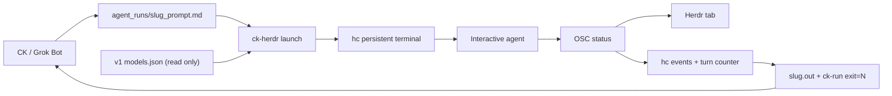

# ck-run v2 on Herdr

`ck-herdr` is a small interactive launcher using the installed `hc` runtime.
Herdr displays the persistent terminals; this repository supplies the bridge
from CK prompt files to the completion line Grok Bot watches. It uses Python
stdlib only. It does not install or replace ck-run v1.



| Existing concept | Herdr mapping here |
| --- | --- |
| ask | `ask` terminal label; launches appear in the CK space by default. |
| run | A persistent terminal/tab named after the slug. |
| model alias | Read from `~/PhD_local/ck-dispatch/config/models.json`; also a terminal label. |
| stall | A reported `blocked` status returns a blocked result. There is no watchdog or screen-text inference. |
| wake | The final `ck-run exit=N` line in `agent_runs/<slug>.out` is compatible with the existing watcher. No message is sent. |
| ledger, budgets, andon, reviews | Remain in v1. This launcher does not call or enforce those workflows. |

Use the existing CK process to authorize work and check its budgets/andon
before launching. This is a transport prototype, not a replacement policy gate.

## Use

Put the complete authorized task and output contract in
`~/PhD_local/agent_runs/<slug>_prompt.md`, then run:

```sh
bin/ck-herdr launch my-task --model sol --cwd ~/PhD_local/ck-herdr \
  --ask A-example --title 'Task title'
bin/ck-herdr ls
```

The launcher starts `hc run --bg --outlive-parent`, labels the terminal, and
blocks on `hc events --terminal <slug>` for agents with status reports. Run it in a persistent supervising terminal when
the completion watcher must survive closing the invoking shell. The agent
terminal itself outlives the launcher. The title becomes part of the initial
task; the tab name remains the slug.

Launches hold a repository-local advisory file lock (`.space.lock`) around looking up the space named `CK` with `herdr-app ls` and creating it in `~/PhD_local/agent_runs` when missing. Use `--space NAME` to choose another name. The resolved `herdr.space` label is passed in the initial `hc run`, so the window can show the agent as a tab. If the app or window is unavailable, the agent still launches with one warning. Dry-run only prints the planned lookup, conditional creation, and label; it makes no app or core calls.

Dry-run works before or after the subcommand, including the requested form:

```sh
bin/ck-herdr launch --dry-run my-task --model sol --cwd ~/PhD_local/ck-herdr
bin/ck-herdr --dry-run launch my-task --model sol --cwd ~/PhD_local/ck-herdr
```

It prints the run/label/wait/read commands and output path. It performs no
`hc` calls and writes no files; a prompt file need not exist for this preview.
Live launches require the prompt file and refuse an existing `.out`, including
a symlink. Names follow `hc run --help`: lowercase letters, digits, hyphen,
underscore, and at most the length allowed there. Uppercase CK ask identifiers
belong in `--ask`, not the slug.

`ls` is a plain tab-separated table of live terminals tagged `ck-herdr=true`.
It uses the server's label filter, then `hc get` for the labels omitted from
compact list rows. It does not enumerate unrelated run files or change tabs.

## Commands and safety

The current alias file contains agent/model/effort metadata, not shell lines.
The launcher constructs an interactive command for each supported agent:

| Agent | Invocation behavior |
| --- | --- |
| codex | `codex --no-daemon --sandbox workspace-write --approve-for-me -m MODEL`; verified reasoning effort from the alias file. |
| claude | `claude --model MODEL`; verified effort when configured; normal permission handling. |
| cursor | `agent --auto-review --sandbox enabled --model MODEL --plugin-dir /absolute/path/to/ck-herdr/cursor-plugin`. |
| agy | `agy --prompt-interactive TASK`; default model when the alias has none. |

There is no `codex exec`, print mode, shell evaluation, or permission bypass.
The optional argv-array `command` alias form exists for local fake fixtures.
Known bypass flags in such arrays are removed with a stderr and `.out` note;
permission-disabling modes are removed too. Other arbitrary config overrides
and noninteractive invocations are refused. No unsafe flags were present in
the real alias metadata read for this build.

The supported agent command shapes were checked against installed CLI help.
A permission dialog can require human action in the Herdr tab.
See the scoped live-check evidence below for the current checks.

## Results and terminal lifetime

The `.out` contains command diagnostics, `hc` results, collected terminal text,
a `ck-run: status=...` line, and the final watcher line. These are transport
results, not acceptance of the agent's work or validation of its output files.

| Final line | Meaning |
| --- | --- |
| `ck-run exit=0` | hc reported root `done`, or `idle` after work (hc turn advanced or an observed `working` to `idle` transition). |
| `ck-run exit=1` | Root status `blocked`, or idle with no work during the observation window (partial). |
| `ck-run exit=2` | Cursor completion is `unknown` at the observation deadline; read the retained tab. No completion status arrived. |
| `ck-run exit=3` | Error, unexpected process exit, timeout, interrupted launcher, or failed collection. |

These numeric mappings are defined in `bin/ck-herdr` (`outcome` and error
handling) and exercised in `tests/test_ck_herdr.sh`. An unexpected exit counts
as an error even if the process exit code is zero: it does not prove a task
reported done. A fast script must keep its final status visible long enough
for the waiter to observe it; the test fixture deliberately does this.

The event subscription starts with an atomic terminal snapshot and follows root
status and turn facts. Startup idle is ignored while waiting for work; idle
with no work stays partial at the observation deadline. Blocked/error and
unexpected process exit keep their existing meanings. A lost event stream or
missed events fail collection. Terminal text is collected for inspection and
is never parsed to determine completion.

Cursor launches load only the repository's `cursor-plugin/` through
`--plugin-dir`. Its documented `beforeSubmitPrompt` and `stop` command hooks
read JSON, return JSON on stdout, and write Herdr OSC status to `/dev/tty`.
A completed stop maps to done; aborted maps to blocked; error maps to error.
Missing or malformed stop status cannot report done. No prompt text is stored.
No user or project `.cursor/` settings, trust flags, or bypass flags are added.

Cursor uses the same bounded hc event observation as other agents. If no
completion status arrives, the launcher retains the explicit
`status=unknown; ... read the tab` fallback and its existing unknown exit code.
Screen text never establishes completion.

**Real check limitation:** the requested read-only Grok check with the installed
CLI returned unknown. Its reply appeared, but hc still had `reported=false` and
`status=null`. The CLI log contains no stop or beforeSubmitPrompt execution event
for that session. The underlying reason is **UNKNOWN**; this does not establish
that Cursor CLI universally cannot run plugin hooks. The hook-to-tty path passes
in the fake suite; real Grok completion through this plugin remains **UNVERIFIED**.
See `tests/artifacts/cursor-hook-real/result.txt`, `terminal-final.json`,
`hook-diagnostics.json`, and `screen.txt`. Only that test terminal was removed.
Official format references: [Cursor hooks](https://cursor.com/docs/hooks) and
[plugin reference](https://cursor.com/docs/reference/plugins).

The observation deadline defaults to the hc wait default recorded in
`tests/artifacts/wait-help.txt`; tests can shorten it with
`CK_HERDR_WAIT_TIMEOUT` (positive finite seconds). The launcher uses blocking
event reads, with no sleeps or state polling. All terminals remain available
for inspection and steering:

```sh
hc attach my-task
hc read my-task
# After accepting the work, clean up only that terminal:
hc kill my-task
hc rm my-task
```

## Test and evidence

```sh
./tests/test_ck_herdr.sh
```

The shell test uses the real installed `hc` and a local fake program emitting
OSC working/done and working/idle reports. It checks no-work idle, Cursor unknown, Cursor-only plugin argv and actual hook commands on an hc PTY, concurrent space creation, completion, labels, listing, persistence,
duplicate protection, bypass removal, and the real `sol` alias in dry-run only.
It kills/removes its own terminal and stops only its private test core.
The suite never launches a real model. Test state uses a unique `HC_SESSION` and
repo-local XDG directories/socket, so the user's core is unaffected.

`tests/artifacts/test-results.txt` records the executed check results.
`status-regression-before.txt` and `status-regression-after.txt` show the
failing-then-passing status and space-race regressions. `fake-idle.out`,
`fake-never.out`, and `fake-cursor.out` retain isolated real-hc fake-agent proof.
`tests/artifacts/fake-run.out`, `fake-terminal.json`, `fake-exit.json`,
`fake-list.txt`, and `sol-dry-run.txt` retain the corresponding proof.
The scratch directory is ignored by git. If the Mac sandbox denies sockets
or startup, report the real-hc check as **NOT RUN**, retaining the dry-run and
diagnostics; do not substitute a mocked hc pass.

Test-only environment overrides: `CK_HERDR_HC` selects the hc executable,
`CK_HERDR_RUNS_DIR` selects a scratch prompt/output directory, and
`CK_HERDR_MODELS` selects a fixture alias file. Normal defaults point to the
existing installed hc, agent_runs, and read-only v1 alias configuration.

## Scoped live check for A-1115-12

`tests/artifacts/real-check-results.txt` records the final lines: Sonnet returned
`status=done` / `ck-run exit=0`; Grok returned `status=unknown` /
`ck-run exit=2`. The launches used `~/PhD_local/agent_runs` as cwd, with prompts
and outputs under `tests/artifacts/real-runs/` to respect this run's write scope.
`launch-timing.json` records the requested spacing. The retained screen captures
show each requested read-only reply. Screen text did not determine either
launcher result. Grok's final hc record still has no status report.

`run-real-check.py` is the separate, explicitly authorized live-check helper;
it is not run by the fake suite. The kill/remove records and before/after
terminal snapshots show cleanup of only its new test terminals. Both launches
used the same existing CK space. Existing duplicate spaces were left alone.

## Later — not built

- A Herdr mod showing a CK board and ask spaces.
- `hc` templates per lane.
- Simbox as an `hc machine`.

## Reference sources

- Local Herdr manual: `~/PhD_local/agent_runs/herdr_ref/hc_skill.md`.
- Installed command help: `hc run/wait/ls/label/read --help` and agent CLI help.
- [Herdr download page](https://herdr.dev/download/): already-installed software; no download performed here.
- [Herdr core](https://herdr.dev/core/): persistent terminals and the OSC status wire example used by the fake agent.
- `tests/artifacts/hc-schema.json`: schema read from the isolated installed core.
- Read-only CK documentation: `~/PhD_local/ck-dispatch/docs/v4.md` and a finished `.sh`/`.out` launch pair.

## Per-launch Cursor hook evidence

`tests/artifacts/cursor-hook-before.txt` shows the missing plugin argv regression
on the previous launcher. `cursor-hook-after.txt` shows passing stub checks.
`cursor-hook-suite-reviewed.txt` records the full passing isolated-core fake suite;
`fake-cursor-hook-terminal.json` attributes its done status to `ck-cursor-hook`.
`cursor-hook-suite.txt` retains the sandbox-denied attempt, not a test pass.
`run-cursor-hook-check.py` is the separate authorized live-check helper; the fake
suite never calls it. The single real result is retained under `cursor-hook-real/`.
It did not meet the requested real-done acceptance criterion. No second model
run or global configuration workaround was attempted.
