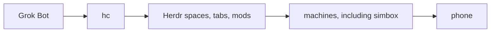

# Herdr ideas for ck-run v2

You want to see the bots, not hunt iTerm windows. Herdr can be that screen. The YouTube demos are almost all the old terminal app (`herdr`, Ctrl-B). ck-run v2 should use the new app and `hc`. Commands from those videos do not copy over.

S / M / L is a guess of build size, not a measured time. A feature is listed only when a video, a written page, or the local Herdr notes say it exists.

| # | Idea | Pain it fixes | Herdr feature | Size | Source |
| --- | --- | --- | --- | --- | --- |
| 1 | One ask gets one space. The worker and the reviewer sit side by side. You still decide. | Feels detached from review and fix. One iTerm window per ask. | Spaces, tabs, a split pane, `hc` reviewer | M | v4 live windows; app `space.new` / `pane.split`; Flavio builder/reviewer; `hc` reviewer example |
| 2 | Official phone app: a list sorted by who needs you, who is done, who is working. Answer there. | Approvals and stalls when you are away. | Phone app talks to `hc` over SSH. Not the old terminal app. | S | herdr.dev/mobile; Flavio, phone section, 2026-11-09 |
| 3 | A sound and a toast when a bot is blocked or finishes while you are not looking. | Stalls. You do not see the bot stop. | App setting `sounds` for done and blocked | S | App guide settings; NetworkChuck 07:31; Data with Marc 05:46 |
| 4 | A pane next to the bot shows the short report, like a live checklist. | You want plain short reports, and you want to see the work. | A mod pane that reads a markdown file | M | Flavio announcement prompt (PLAN.md checklist) |
| 5 | A lead bot starts helpers. You peek at the helpers under it. The lead only taps you when one is blocked. | You cannot see the chain. | `hc wait --children`; the agents list peeks at children | M | `hc` manual; app guide sub-agents; NetworkChuck 14:13 (old app, same wish) |
| 6 | Finished tabs fold away. A tab pops back when its bot needs you. | Too many windows. Stalls hide. | Settled tabs | S | App guide only. Not in the videos. |
| 7 | Pin the bot that needs a decision, on the Mac and on the phone. | Approvals get lost in the list. | Pin on the terminal; swipe pin on the phone | S | App guide pin; herdr.dev/mobile. Old filter: NetworkChuck 08:58 |
| 8 | Each parallel code job gets its own git worktree and its own space. | Parallel bots are hard to see, and they can edit the same files. | Worktree mod (a worktree opens as a space) | M | Elie Steinbock 03:14; NetworkChuck 14:37; Hal Shin 08:37; Practical AI 2026-08-12; app worktree mod |
| 9 | Use the Chat layout so bot updates read like short messages. | Detached feeling. You want short words, not a raw terminal. | Gallery layout "Chat" | S | Flavio layout table; gallery lists Chat. Read the mod before you install it. |
| 10 | After simbox is a machine, test one Mac bot sending a job to a simbox bot. | Simbox is only reachable by SSH. You want to see that work too. | `hc run --on` and `hc send` | L | Local `hc` manual documents it. NetworkChuck 16:00 showed the old app. Flavio says the old CLI still cannot do this across machines. |

Simbox is in the picture. Connecting it is already on the Later list. This page does not build it.

## Top 3 to build first

1. **Sound (idea 3).** One setting. Claude and Codex already report status, so a stall can make a noise today.
2. **Phone app (idea 2).** Same signal, in your pocket. Use the official app. The YouTube phone demos are Telegram or a normal SSH app into the old terminal, and those do not see this core.
3. **One space per ask, review beside the worker (idea 1).** This is the "see the chain" fix. The sound and the phone only help after the bots are on screen.

## Do not treat these as new

Already on Later: idle to done, Grok and Cursor completion, a viewer for Cursor, a lock against two CK spaces, a `--tab` option. The launcher notes also already list a CK board mod, `hc` templates per lane, and simbox as a machine. The gallery Board layout is that board idea.

## Two facts that change the copy

The new core does not guess from the screen. A bot is working, blocked, or done only if it says so. The old app did guess. That is why Grok and Cursor are already on Later, and why idea 3 will not cover them yet.

Flavio keeps agents in one folder with a narrow job, and does not use worktrees on his own site. Use worktrees only for code repos. Do not use them on the OneDrive lab folders.

## Questions for chalach

1. Build the top 3 (sound, phone, one space per ask), or skip the phone?
2. Worktrees only for code repos such as ck-herdr and ck-dispatch. Never the lab folders. Is that the rule?
3. Leave simbox and the board mod on Later until the top 3 exist?
